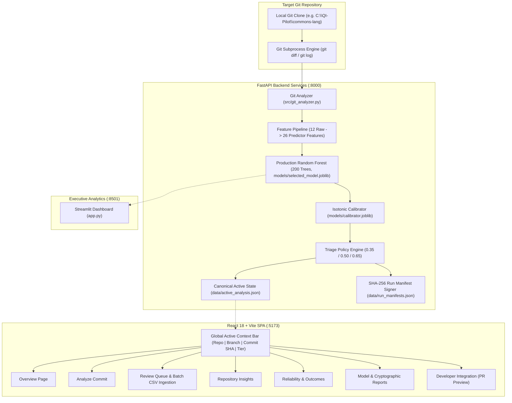

# Quality Intelligence — Code-Change Defect-Risk Predictor

[](file:///docs/TESTING.md)
[](https://www.python.org/)
[](https://fastapi.tiangolo.com)
[](https://react.dev)
[](https://vitejs.dev)
[](LICENSE)

An empirical, production-grade Just-in-Time (JIT) machine learning intelligence platform that analyzes software changes and forecasts defect induction risks prior to merge. Designed to prevent silent software regressions by prioritizing developer code reviews and optimizing QA resource allocation.

---

## 📌 Table of Contents

- [Executive Summary](#-executive-summary)
- [System Architecture](#-system-architecture)
- [Key Features](#-key-features)
- [Scientific Methodology & Dataset](#-scientific-methodology--dataset)
- [Model Evaluation & Benchmarks](#-model-evaluation--benchmarks)
- [Operational Triage Policies](#-operational-triage-policies)
- [Apache Commons Lang Pilot Case Study](#-apache-commons-lang-pilot-case-study)
- [Installation & Quickstart](#-installation--quickstart)
- [API Reference](#-api-reference)
- [Automated Testing](#-automated-testing)
- [Scientific Limitations & Ground Truth](#-scientific-limitations--ground-truth)
- [License](#-license)

---

## 🚀 Executive Summary

Software defect prediction traditionally operates at the release or file level—identifying complex modules only after code has already landed. **Quality Intelligence** operates at the **commit granularity (Just-in-Time)**:
1. Mines raw change geometry, diffusion, file history, and author experience directly from Git diffs.
2. Derives 26 strictly ordered predictor features.
3. Scores defect likelihood using a frozen, regularized 200-tree Random Forest classifier calibrated via Isotonic Regression.
4. Triages changes into actionable review tiers (`Critical Risk`, `Elevated Risk`, `Moderate Risk`, `Standard Review`) with dynamic budget allocation and cryptographic run manifests.

---

## 🏗️ System Architecture



Detailed architectural contracts are documented in [docs/ARCHITECTURE.md](docs/ARCHITECTURE.md).

---

## ⚡ Key Features

- **Real Git Integration**: Analyzes local Git repositories directly without requiring credential exposure or branch modification.
- **Unified Canonical State**: Synchronized across 7 dedicated views; analyzing a commit updates the active top bar, review queues, and developer integration simultaneously.
- **Review Queue CSV Ingestion**:
  - Supports **Format A (12 raw Git metrics)** with automatic alias normalization (`lines_added` $\to$ `la`, `modified_files` $\to$ `nf`, etc.) and safe median imputation.
  - Supports **Format B (26 pre-engineered features)** passed directly to the model.
  - Downloadable templates with synthetic commits.
  - Row-level validation modal and full commit inspection drawer.
- **Top-K Review Budget Optimizer**: Allocate limited engineering review capacity (e.g. top 20% most risky commits) dynamically.
- **Developer Workflow & PR Preview**: Generates automated markdown pull-request risk advisories with zero merge-blocking risk.
- **Cryptographic Auditability**: Every inference run outputs a tamper-evident SHA-256 run manifest.

---

## 🔬 Scientific Methodology & Dataset

### Dataset: ApacheJIT Benchmark
- **Total Dataset**: **106,674 commits** across 15 premier Apache open-source projects (Camel, Hadoop, Flink, Cassandra, HBase, Groovy, Ignite, etc.).
- **Target Label (`buggy`)**: Constructed using the SZZ algorithm (linking bug-fixing Jira issues to origin commits via `git blame`).
  - Clean commits: **73.53%** (78,435 commits)
  - Defect-inducing commits: **26.47%** (28,239 commits)
- **Leakage Prevention**: Strictly partitioned using chronological splitting. Historical experience and file age features are calculated strictly using commits prior to the target commit timestamp.

### 26 Extracted Features

| Dimension | Metrics / Feature Name | Description |
| :--- | :--- | :--- |
| **Diffusion** | `nf`, `nd`, `ns`, `ent`, `files_per_subsystem`, `directories_per_file` | Number of files, directories, subsystems modified, and line entropy. |
| **Change Size** | `la`, `ld`, `total_lines_changed`, `net_lines_changed`, `deletion_ratio`, `log1p_la`, `log1p_ld`, `log1p_total_lines_changed` | Absolute and logarithmic scale lines added, deleted, and churn ratios. |
| **File History** | `ndev`, `age`, `nuc`, `log1p_age`, `log1p_nuc` | Past unique developers on files, mean file age in days, prior change counts. |
| **Experience** | `aexp`, `arexp`, `asexp`, `experience_gap`, `log1p_aexp`, `log1p_arexp`, `log1p_asexp` | Author lifetime commits, recent weighted activity, subsystem familiarity. |

Full feature derivations are detailed in [docs/METHODOLOGY.md](docs/METHODOLOGY.md).

---

## 📊 Model Evaluation & Benchmarks

Evaluated on the strict chronological future holdout test partition ($N = 30,111$ commits):

| Metric | Score | Industry Context |
| :--- | :---: | :--- |
| **ROC-AUC** | **0.781** | Strong discriminative capability across multi-project distributions |
| **PR-AUC (Average Precision)** | **0.542** | $\mathbf{+104\%}$ improvement over random prevalence baseline (0.265) |
| **Brier Score (Calibrated)** | **0.158** | Low mean squared error of predicted probabilities |
| **Recall @ Top 20% Budget** | **68.4%** | Captures nearly 70% of all regressions while reviewing only 20% of changes |

Detailed benchmarks and cross-project stability metrics are in [docs/MODEL_EVALUATION.md](docs/MODEL_EVALUATION.md).

---

## 🎯 Operational Triage Policies

Rather than an arbitrary fixed threshold, Quality Intelligence provides three operational review policies:

| Policy | Threshold ($\tau$) | Holdout Recall | Holdout Precision | Review Workload | Use Case |
| :--- | :---: | :---: | :---: | :---: | :--- |
| **🔴 High-Recall** | `0.35` | **91.5%** | 29.2% | 60.5% | Core architectural libraries, security-critical modules |
| **🟠 Balanced (Default)** | `0.50` | **83.1%** | 34.8% | 46.2% | Standard sprint cadence and trunk-based integration |
| **🟡 High-Precision** | `0.65` | **68.4%** | 42.0% | 31.5% | High-velocity microservices, continuous delivery pipelines |

---

## 🏆 Apache Commons Lang Pilot Case Study

The platform was validated end-to-end against the Apache Commons Lang repository:

- **Target Repository**: `C:\QI-Pilot\commons-lang`
- **Analyzed Commit**: `b9b30efb01e861a16503232bb96b684107e73199`
- **Subject**: `Rename ReflectionToStringBuilderOverrideExclude so Surefire runs it (#1830)`
- **Author**: Sharang Gupta
- **Measured Metrics**: Lines Added: `78`, Lines Deleted: `78`, Modified Files: `2`
- **Model Score**: **`0.5478`** (`54.8%`)
- **Triage Result**: **`Elevated Risk`** (`FLAGGED` under Balanced Policy $\tau = 0.50$)
- **Actionable Advice**: Mandatory peer review recommended; inspect changed test patterns and verify test suite coverage across reflection subsystems.

---

## 💻 Installation & Quickstart

### Prerequisites
- Python 3.10+
- Node.js 18+ (`npm` 9+)
- Git 2.30+

### Setup Commands
```bash
# 1. Clone repository
git clone https://github.com/Sanjayt215/Quality-Intelligence.git
cd Quality-Intelligence

# 2. Setup Python environment
python -m venv .venv
source .venv/bin/activate  # On Windows: .venv\Scripts\Activate.ps1
pip install -r requirements.txt

# 3. Setup Frontend
cd frontend
npm install
cd ..
```

### Launching the Application
Open three terminal tabs:
```bash
# Tab 1: FastAPI Backend (Port 8000)
python -m uvicorn backend.main:app --host 0.0.0.0 --port 8000

# Tab 2: React + Vite Frontend (Port 5173)
npm --prefix frontend run dev -- --host 0.0.0.0 --port 5173

# Tab 3 (Optional): Streamlit Executive Dashboard (Port 8501)
python -m streamlit run app.py --server.port 8501
```

For containerized deployment, see [docs/INSTALLATION.md](docs/INSTALLATION.md).

---

## 🔌 API Reference

The FastAPI service exposes high-performance typed endpoints:

| Endpoint | Method | Description |
| :--- | :---: | :--- |
| `/api/health` | `GET` | Health status and model readiness probe |
| `/api/model/info` | `GET` | Model hyperparameters, training metadata, and feature ordering |
| `/api/analyze` | `POST` | Single-commit JSON or batch CSV multipart upload inference |
| `/api/analyze/git-commit` | `POST` | Mines and analyzes a local Git repository commit |
| `/api/analyze/git-branch` | `POST` | Discovers and analyzes a batch of commits on a remote/local branch |
| `/api/templates/{name}` | `GET` | Downloads validated CSV templates (raw-metrics / engineered-features) |
| `/api/active-analysis` | `GET` | Retrieves canonical active analysis context shared across UI views |
| `/api/analytics/powerbi-csv` | `GET` | Exports analysis history formatted for Power BI reporting |

Interactive OpenAPI documentation is available at `http://localhost:8000/docs`.

---

## 🧪 Automated Testing

The automated test suite contains **222 test cases** across 24 test modules:

```bash
# Run complete test suite
pytest -v

# Run batch CSV ingestion and model verification tests
pytest tests/test_review_queue_csv.py tests/test_dashboard.py -v
```

See [docs/TESTING.md](docs/TESTING.md) for full test architecture and coverage details.

---

## ⚠️ Scientific Limitations & Ground Truth

1. **SZZ Labeling Scope**: SZZ labels commits that caused any future bug report, including feature bugs, logic errors, and integration failures. It is not restricted solely to regressions of existing passing tests.
2. **Cross-Project Generalization**: While calibrated on diverse Apache Java projects, repositories with vastly divergent coding styles, monorepo structures, or automated bot-generated commits may exhibit epistemic uncertainty. The application reports uncertainty warnings when change metrics deviate outside the training distribution.
3. **No Merge Blocking**: Quality Intelligence is strictly an **advisory intelligence tool**. It does not automatically block merges or fail CI pipelines without human verification.

---

## 📄 License

Licensed under the **Apache License, Version 2.0**. See [LICENSE](LICENSE) for terms.
