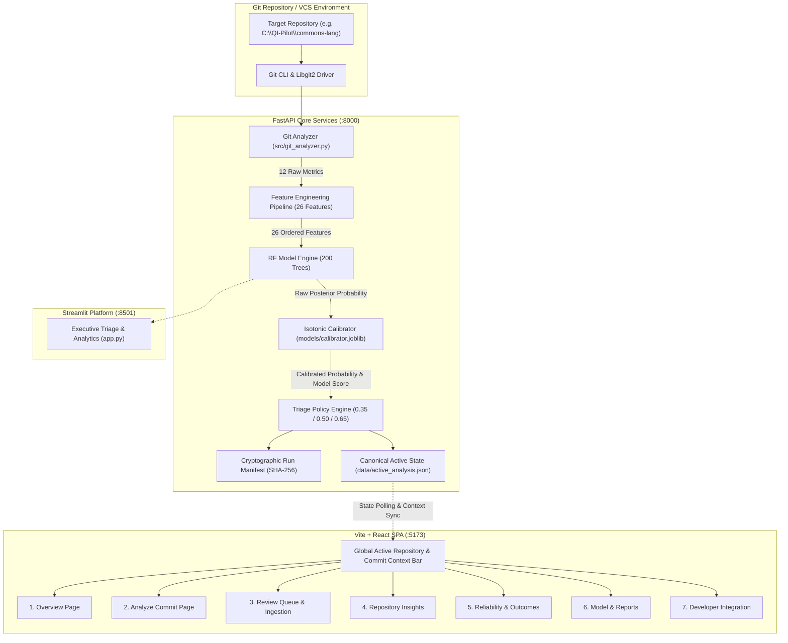

# System Architecture — Quality Intelligence

Quality Intelligence is a real-time, just-in-time (JIT) code-change defect-risk prediction and review-triage system. It bridges low-level software repository mining with production machine learning to prioritize developer code reviews before silent regressions reach production branches.

---

## 1. High-Level System Architecture

---

## 2. Core Architectural Subsystems

### A. Repository Mining & Diff Extraction (`src/git_analyzer.py`)
- Direct integration with local Git repositories via subprocess calls (`git diff`, `git log`, `git rev-parse`).
- Extracts change geometry without modifying target repositories, committing, or checking out branches.
- Measures author temporal metadata and file historical statistics strictly prior to the commit target timestamp, preventing temporal lookahead bias.

### B. Feature Engineering & Preprocessing (`src/dashboard_utils.py`)
Transforms 12 measured change metrics into the exact 26-feature feature space required by the production classifier:
1. **Raw Dimensions**: `la`, `ld`, `nf`, `nd`, `ns`, `ent`, `ndev`, `age`, `nuc`, `aexp`, `arexp`, `asexp`.
2. **Interaction Metrics**: `total_lines_changed`, `net_lines_changed`, `deletion_ratio`, `files_per_subsystem`, `directories_per_file`, `experience_gap`.
3. **Log-Transformed Metrics**: $\log(1 + x)$ transformations for skewed change volume and experience dimensions (`log1p_la`, `log1p_ld`, `log1p_total_lines_changed`, `log1p_age`, `log1p_nuc`, `log1p_aexp`, `log1p_arexp`, `log1p_asexp`).

### C. Inference & Model Pipeline (`models/`)
- **Primary Model**: Frozen Random Forest Classifier (`models/selected_model.joblib`), consisting of 200 trees with `max_depth=12`, `min_samples_leaf=10`, and deterministic `random_state=42`.
- **Calibration Engine**: Isotonic Regression model (`models/calibrator.joblib`) producing empirically calibrated posterior probabilities.
- **Triage Thresholds**: Dynamic operational thresholds:
  - **High-Recall Policy ($\tau = 0.35$)**: Catches $>91\%$ of defects for mission-critical core libraries.
  - **Balanced Policy ($\tau = 0.50$, Default)**: Balances detection rate (~83%) with reviewer capacity.
  - **High-Precision Policy ($\tau = 0.65$)**: For high-velocity teams minimizing false alarms.

### D. Single Canonical Source of Truth (`data/active_analysis.json`)
All 7 frontend pages bind to a centralized active-state repository:
- Repository identification and path.
- Selected branch and resolved Git commit reference.
- Author, subject, and line-level changes.
- Defect risk score, risk tier, review recommendation, and cryptographic manifest signature.

### E. Cryptographic Audit & Compliance (`data/run_manifests.json`)
Every single-commit analysis or batch evaluation generates an immutable SHA-256 execution manifest capturing:
- Complete input features.
- Model hyperparameters, version hash, and policy thresholds.
- Timestamp and execution duration.
- Tamper-evident cryptographic signature.
